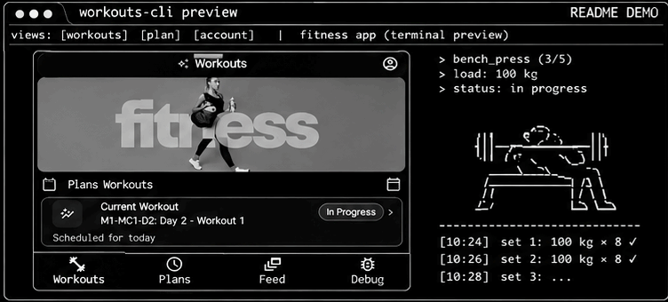
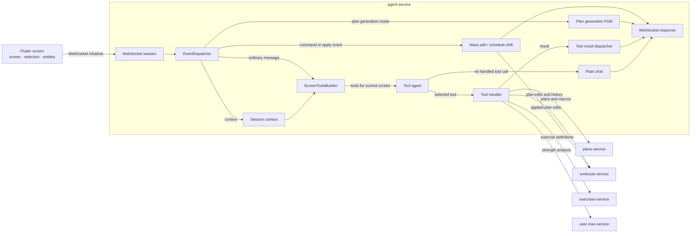

## Components

| Path | Responsibility |
| --- | --- |
| `gateway/` | HTTP entry point for the client; proxies requests to services |
| `services/` | Accounts, exercises, plans, workouts, strength calculations, CRM, and agent services |
| `social-service/`, `messaging-service/`, `webhook-dispatcher/` | Social data, messaging, and webhook delivery |
| `analytics/` | CDC configuration and scripts for the analytics pipeline |
| `proto/` | Protocol Buffer contracts and generated Python stubs for gRPC calls |

The Flutter client lives in the separate [athletic-performance-clients repository](https://github.com/oleksiikomarychev/athletic-performance-clients).

## Development workflow

Start with [AGENTS.md](AGENTS.md) and the [development workflow](docs/development/README.md).
Behavior changes use OpenSpec; [edge cases](docs/edge-cases/README.md) preserve reproducible
regressions, and [decisions](docs/decisions/README.md) preserve agreed choices and their reasons.
The [specification candidates](docs/development/spec-candidates.md) track areas to discuss.

## Agent behavior

### Tools by screen

| Screen | Available tools |
| --- | --- |
| `active_plan` | Schedule shift, applied-plan mass edit, plan analysis |
| `coach_athlete_plan` | Applied-plan mass edit, plan analysis, athlete history |
| `plan_details` | Plan macros analysis and management, plan analysis |
| `user_profile` | Completed-workout analysis |
| `calendar_plans` | Plan recommendations from the plans in screen context |
| `user_max`, `analytics` | Strength-data analysis |
| `coach_athletes` | Coach portfolio analysis |
